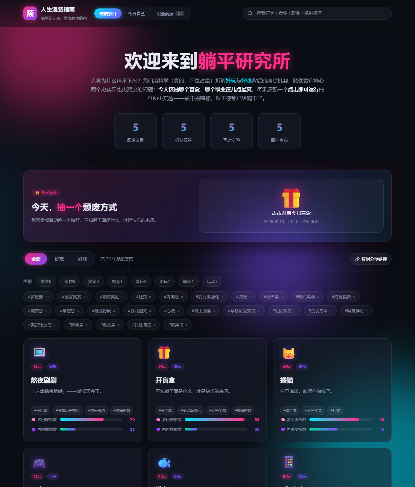

# 人生浪费指南 · 躺平研究所

一份「当代人如何心安理得地浪费时间」的图鉴：把最常见的**好玩行为**和**好吃的东西**逐条拆解，
讲清楚它们到底**爽在哪个机制上**，并给每条配一个**点一下就能跑**的原生互动小实验，
直观演示那个机制是怎么让人上头的。

这份文档的目的不是教你怎么部署，而是帮你**认识有哪些好玩的项目**，以及**这些项目是怎么做出来的**——
每个实验都是一段可读、可抄、可改的纯前端代码。

零构建、零运行时依赖，双击 `index.html` 就能玩，也能直接部署到 GitHub Pages。

[](https://wanfeng-vesper.github.io/lying-flat-handbook/)

🔗 **点这里直接体验 → <https://wanfeng-vesper.github.io/lying-flat-handbook/>**



---

## 有哪些好玩的项目

一共 **45 个互动条目**（好玩 37 · 好吃 8）+ **21 个职业的爽感时刻表**。每个条目点开都有一句话爽点、通俗科学解释、机制标签，以及一个可运行的互动实验。

### 好玩类
- 熬夜刷剧 · 开盲盒 · 撸猫 · 再来一局 · 摸鱼 · 刷短视频

#### 更多运动类
- 夜跑 / 运动 · 打篮球 · 游泳 · 骑行 · 撸铁 / 健身 · 羽毛球 · 瑜伽

#### 常见宠物
- 撸狗 · 观赏鱼 / 水族箱 · 仓鼠 / 金丝熊 · 养鹦鹉 · 养兔子

#### 异宠
- 睫角守宫 · 角蛙 · 玉米蛇 · 蜜袋鼯 · 非洲迷你刺猬 · 捕鸟蛛 · 寄居蟹 · 六角恐龙（钝口螈）

#### 社交桌游
- 狼人杀 · 剧本杀 · 打麻将 · 掼蛋 / 斗地主

#### 户外运动
- 爬山 / 徒步 · 拼豆

#### 场景卡（通勤 / 午休 / 周末）
- 通勤听播客 · 午休小手工 · 随手折纸 · 冥想呼吸 · 拼一幅图
- （其中「周末做一顿饭」「手冲一杯咖啡」归好吃类，见下）

### 好吃类
- 奶茶 · 螺蛳粉 · 泡面 · 炸鸡 · 火锅 · 甜品 · 周末做一顿饭 · 手冲一杯咖啡

### 还有这些彩蛋
- **🎁 今日盲盒 · 躺平抽签机**：每天零点自动换一个「今日推荐」，点击开盒有抖动 + 光爆 + 粒子动画；不喜欢就「换一个」连抽，结果由日期做种子、当天稳定。
- **🧑‍💼 职业爽感时刻表**：21 个职业 × 24 小时热力表，拖动时间轴看「此刻最爽的是谁」，点职业名看爽感峰值与机制科普。

---

## 这些项目是怎么实现的

### 总体思路：数据驱动 + 实验即插件

代码分成三块，互不耦合：

| 文件 | 职责 |
| --- | --- |
| `assets/js/data.js` | 纯数据：45 条条目 + 21 个职业 + 机制标签词表 |
| `assets/js/app.js` | 渲染、搜索、筛选、hash 路由、职业时刻表、盲盒 |
| `assets/js/labs.js` | 45 个互动实验（每个条目一个，同名 key） |

**一条条目 = 一段数据 + 一个同名实验函数**。新增项目时只在 `data.js` 加一条、在 `labs.js` 注册一个实验，`app.js` 的渲染/搜索/筛选会自动覆盖，不用改。

### 互动实验怎么做（以「撸猫」为例）

`labs.js` 里每个实验都是一个工厂，约定返回 `{ destroy }` 以便关闭弹层时清理：

```js
window.GUIDE_LABS = {
  cat: {
    init: function (container) {
      // 1) 用 Canvas 画一只猫，requestAnimationFrame 跑动画循环
      // 2) 用 btn() 工厂生成按钮，自动挂全局点击音效
      // 3) 抚摸按钮触发专属音效 + 猫的动画状态切换
      // 4) 返回 destroy() 停掉动画、解绑监听
      return { destroy: function () { /* 清理 */ } };
    }
  }
  // ...
};
```

要点：
- **按钮统一走 `btn(label, cls, onClick)`**：点击时自动播放全局音效，实验作者只管业务逻辑。
- **懒挂载**：实验只在详情弹层展开时才 `init`，关闭时 `destroy`，没有后台空转的动画。
- **无图片依赖**：图形全靠 Canvas 2D + 内联 SVG + emoji，断网也能跑。

### 声音怎么做

用浏览器原生 **Web Audio API**，一个 `beep()` 封装振荡器就够：

```js
function beep(freq, dur, type, vol, when) {
  var ac = audioCtx();                       // 懒创建 AudioContext（首次点击后）
  var o = ac.createOscillator(), g = ac.createGain();
  o.type = type || "sine"; o.frequency.value = freq;
  g.gain.linearRampToValueAtTime(vol, ac.currentTime + 0.012);
  g.gain.exponentialRampToValueAtTime(0.0001, ac.currentTime + dur);
  o.connect(g); g.connect(ac.destination); o.start(); o.stop(ac.currentTime + dur + 0.03);
}
```

- 猫狗有专属音效：`sfxPet()`（呼噜声 = 两个正弦波叠加）、`sfxFeed()`、`sfxToy()`、`sfxFrisbee()`。
- **全局点击声按按钮文案做哈希，散出不同音高**——所以每个实验的按钮听起来略有性格，而不是千篇一律的「嘀」。
- 右上角 🔊 开关控制 `soundOn`，关掉后全部静音。

### 动画 / 视觉

- 暗色霓虹主题，纯 CSS 变量 + Grid/Flex + 关键帧，无 UI 框架。
- 多巴胺 / 内啡肽双指数用进度条直观对比（多巴胺 = 青→粉、内啡肽 = 绿→紫）。
- 尊重 `prefers-reduced-motion`，开启减弱动画时降级为只保留数值与颜色变化。

### 筛选 / 搜索 / 分享状态

- 标签云（机制）+ 类别栏（美食 / 宠物 / 异宠 / 电竞…）+ 分类切换（全部 / 好玩 / 好吃）可叠加筛选。
- 顶部搜索框输入即过滤，命中词高亮；搜索词、标签、类别、分类写入 URL hash，刷新保持、链接可分享。

### 盲盒 & 职业时刻表

- **盲盒**：用「日期」做哈希种子决定当日推荐，同一天刷新结果稳定；`localStorage` 记住已开过的结果。
- **职业时刻表**：21×24 二维热力表，时间轴可拖动，「回到此刻」实时显示当前最爽职业与 Top 6 排行。

---

## 如何新增一个项目（你自己也能加）

### 1. 在 `assets/js/data.js` 的 `window.GUIDE_ITEMS` 里加一条

```js
{
  id: 'myItem',            // 唯一 id，和下面实验 key 一致
  cat: 'fun',              // 'fun'(好玩) 或 'food'(好吃)
  name: '示例行为',
  emoji: '🎲',
  hook: '一句话爽点',
  why: '「好玩/好吃在哪」科普正文，机制名会被自动高亮…',
  tags: ['多巴胺', '变比率强化'],
  lab: 'myItem'            // 对应 labs.js 中的实验 key
}
```

### 2. 在 `assets/js/labs.js` 的 `window.GUIDE_LABS` 注册同名实验

```js
myItem: {
  init: function (container) {
    // 绑定点击、启动动画，返回带 destroy() 的对象
    return { destroy: function () { /* 清理监听 + 停止动画 */ } };
  }
}
```

### 3. 不用改 `app.js`

渲染、搜索、筛选、hash 路由会自动覆盖新条目；新实验也自动获得全局点击音效。

### 附：如何新增一个职业（爽感时刻表）

在 `assets/js/data.js` 的 `window.GUIDE_JOBS` 数组追加一条即可：

```js
{
  id: 'myJob', emoji: '🧪', name: '示例职业', field: '技术派',
  peak: '03:00–05:00',
  moment: '一句话画面感爽点',
  why: '「爽在哪」科普正文，机制名会被高亮…',
  tags: ['心流', '掌控感'],
  score: { dopamine: 78, endorphin: 33 },
  peaks: [{ from: 3, to: 5, heat: 88 }]
}
```

---

## 目录结构

```
指南/
├── index.html            # 唯一页面
├── assets/
│   ├── css/style.css     # 暗色霓虹主题
│   └── js/
│       ├── data.js       # 45 条条目数据 + 21 条职业数据 + 标签
│       ├── labs.js       # 45 个互动实验（含音效）
│       └── app.js        # 渲染 / 搜索 / 筛选 / hash 路由 / 职业时刻表 / 盲盒
├── README.md
├── .nojekyll
└── .gitignore
```

## 技术说明

- 纯静态：HTML5 + 原生 CSS（变量 / Grid / Flex / 关键帧）+ 原生 JavaScript（经典 `<script>` 顺序加载，无打包、无 ES Module / fetch）。
- 图形：Canvas 2D + 内联 SVG + emoji，无任何图片外链、字体外链或 CDN 依赖。
- 声音：Web Audio API 振荡器合成，零音频文件。
- 实验在详情弹层展开时才初始化（懒挂载），关闭时销毁，避免后台动画空转。
- 尊重 `prefers-reduced-motion`，降级为仅保留数值与颜色变化。

## 怎么打开

直接**双击 `index.html`** 用浏览器打开即可（离线、断网均完整可用，因为全部资源用相对路径且不用 ES Module / fetch）。
想分享给别人就发上面的在线体验链接。
